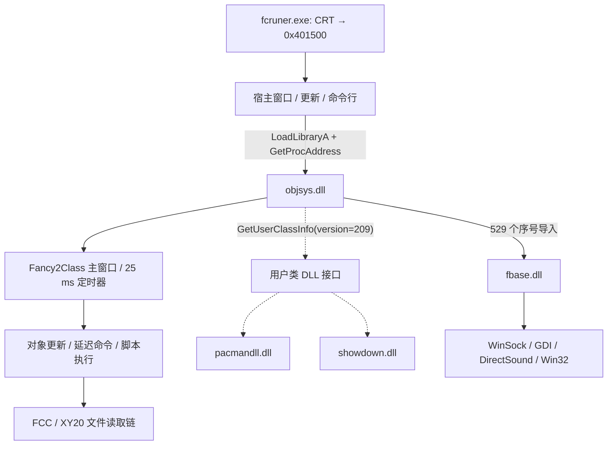

# fcruner / FancyBox 客户端实现分析

静态分析日期：2026-10-15。入口：`CLIENT/fcruner.exe`。本报告依据实际分发文件进行 REA 静态分析，涵盖目录内全部 6 个 PE 文件，以及 FCC 资源的格式调查。没有执行原版 Windows 程序，也没有访问文件中出现的历史服务器。2026-10-16 的 Go 实现运行进展另见本报告末尾；该运行验证不代表原版客户端行为。

## 1. 核心结论

`fcruner.exe` 是 FancyBox 的启动、更新和宿主窗口程序。主要实现分布在 `objsys.dll`（对象系统、脚本、窗口和插件调度）与 `fbase.dll`（底层容器、文件、图形、声音、网络等基础设施）。目录中的 `.fcc` 资源承载了进一步的应用内容，因此仅反汇编 EXE 不能恢复完整游戏逻辑。

观察到的主链如下。实线为已定位的代码关系；虚线为接口能力，尚不能证明某一 FCC 实际使用某一游戏插件。



主启动链证据：R1、R2；插件接口证据：R2、R4、R5。DLL 导入数量和解析结果来自补充 PE 结构解析 S1，不是反编译器推断。

## 2. 样本与地址约定

所有目标均为 I386 PE32 原生程序，没有发现 CLR 头。下文地址均为各自模块的首选虚拟地址（VA），不是实际运行时地址。多个 DLL 的首选基址同为 `0x10000000`，必须同时指定模块；Windows 加载时可能发生重定位。

| 文件 | 字节数 | PE 入口 VA | 角色及依据 |
|---|---:|---|---|
| `fcruner.exe` | 81,920 | `0x004066e2` | 启动和更新宿主，动态查找 FancyBox 两个入口 |
| `objsys.dll` | 1,040,384 | `0x1008976d` | 导出 FancyBox 接口，包含对象、脚本和插件系统 |
| `fbase.dll` | 438,272 | `0x100360be` | 916 个序号导出，提供被 objsys 使用的基础设施 |
| `service/onepusonenew/game/pacman/bin/pacmandll.dll` | 73,728 | `0x1000633b` | 用户类/插件接口 |
| `service/templeflower/bin/showdown.dll` | 307,200 | `0x10002827` | 用户类/插件接口 |
| `帅哥奇域.EXE` | 149,654 | `0x00418e94` | 独立可执行文件；与 fcruner 的启动关系尚未证实 |

完整 SHA-256、节区、资源和导入导出见 [PE 清单](evidence/pe-inventory.json)。入口 EXE 的 SHA-256 为：

`76f1a1178a0d74f568421aa30249ea259952ddda4960d4b65c2d0f9cde949e1c`

PE 时间戳属于文件内元数据，不能据此确定真实编译日期或软件来源。

## 3. EXE 如何启动引擎

### 初始化顺序

1. CRT 入口 `fcruner:0x4066e2` 经 `0x406868` 调用应用入口 `0x401500`。
2. 上下文构造函数 `0x402d10` 设置默认引擎名 `objsys.dll`（`0x402dad`），调用 `0x4026b0` 计算目录。
3. `0x401500` 将非空命令行交给 `0x402ae0`，注册窗口过程 `0x401210`，经 `0x401020` 创建宿主窗口，然后进入 GetMessage / TranslateMessage / DispatchMessage 消息循环。
4. `0x401020` 创建居中的约 800×600 宿主窗口，并通过 `0x401820` 将自身路径写到 `SOFTWARE\XXT\fcbox2` 的 `runerpath`。
5. `0x4027e0` 查找目标 DLL：优先尝试程序目录下的文件，另有系统目录回退路径；缺失或设置强制更新标志时进入 `0x401c40`。
6. `0x40296c` 调用 LoadLibraryA；`0x4029ef`、`0x402a2b` 附近分别查找 `StdInitFancyBox`、`StdCmdFancyBox`。
7. `0x402a62–0x402a6d` 调用初始化接口，第四个参数为十进制 `100`；初始化返回值必须至少为 1。
8. 存在有效剩余命令时，`0x402aa9–0x402aab` 调用 `StdCmdFancyBox(0, command)`。释放路径 `0x4016e0` 调用 `StdCmdFancyBox(3, 0)` 后 FreeLibrary。

以上均为 R1 中具体指令的静态观察。以下是人工重建的逻辑，不是原始源码，也不是 REA 反编译结果：

```c
/* Analyst reconstruction; option structure and return types remain tentative. */
engine = LoadLibraryA(selected_engine_path);
init = GetProcAddress(engine, "StdInitFancyBox");
cmd  = GetProcAddress(engine, "StdCmdFancyBox");
if (!engine || !init || !cmd) fail();
if (init(host_instance, host_window, options, 100) < 1) fail();
if (has_command) cmd(0, command);
while (GetMessageA(&msg, 0, 0, 0)) {
    TranslateMessage(&msg);
    DispatchMessageA(&msg);
}
cmd(3, 0);
FreeLibrary(engine);
```

### 命令行与窗口消息

`0x402ae0` 按空格拆词，跳转表接受大小写 D、I、S。分支从 token 的第 4 个字符开始取值，分隔符的精确语法不能仅由这一点确定。

| 分支 | 地址 | 已观察行为 |
|---|---|---|
| D/d | `0x402ba9` | 更换 DLL 名，重新计算目录 |
| I/i | `0x402c0c` | 复制到上下文 `+0x78`；语义未完全恢复 |
| S/s | `0x402bd1` | 设置强制更新标志 `+0x68`，复制更新地址到 `+0x5c` |
| 其他参数 | 同一解析函数 | 保留并组合成引擎命令 |

宿主 WM_ACTIVATE（消息 6，wParam 非零）进入 `0x401720`，向引擎发命令 10。WM_SIZE 分支调用 `0x401740`，该函数在此版本直接返回。宿主的 WM_TIMER（`0x4013bd`）执行 ShowWindow 后取消定时器 1000，因此它不是游戏的持续更新循环。持续更新定时器位于 objsys 内部。

`objsys_adv.dll` 虽然存在于 EXE 字符串中，本轮没有定位到其有效使用位置，不能把它列为已经加载的依赖。

### 更新实现

`0x401c40` 构造 `system\fc2info.dat` 路径，再构造远端信息文件路径，执行比较和下载流程；错误路径含 `Check system info`、`Download system info failed` 等文本。下载使用 URLDownloadToFileA；CAB 处理辅助代码在 `0x4030xx` 动态取得 FDICreate、FDICopy、FDIIsCabinet、FDIDestroy。

目录配置涉及 `SOFTWARE\XXT\fcbox3` 的 `cachepath`、`syshomeadd`，回退目录含 `%WINDIR%\fcbox3\`、`C:\fcbox3\`。内置历史地址为 `http://fcbox/download/system`。这些仅是静态默认值，不能证明它们现在有效。

未完整恢复 `fc2info.dat` 格式、更新事务与所有校验规则，也没有据此宣称存在或不存在签名校验。证据：R1。

## 4. objsys 对象系统与运行循环

### 两个导出接口

| 导出 | 序号 | VA |
|---|---:|---|
| `StdInitFancyBox` | 2 | `0x10009bc0` |
| `StdCmdFancyBox` | 1 | `0x10009e40` |

初始化入口执行 CoInitialize，设置模块信息，检查全局实例和调用者版本。`0x10009d23` 附近要求接口版本至少为 `100`；不满足时记录 `StdInitFancyBox version err!`。之后调用类注册 `0x1005bcb0`、选项初始化 `0x10009f50`，分配 `0x2538` 字节根对象，经 `0x10064920` 构造，将其保存到全局 `0x100ca1f0`。对象虚表 `0x100a3bb0` 的 `+0x84` 槽指向 `0x10065430`。

`0x10065430` 注册 `Fancy2Class`，窗口过程为 `0x10064f90`，创建名为 `FancyMainWnd` 的窗口，将对象指针放入 GWL_USERDATA。`0x100656d5` 调用 `0x10063360` 进行基础初始化，加载 `GB2BIG5`、`BIG52GB` 资源并设置缓存目录。注意该引擎内部使用 `fcbox2` 配置，而 EXE 更新路径使用 `fcbox3`，不能把两者混成一个目录。

`0x100656e0–0x100656f1` 设置定时器 1，间隔 `0x19`（25 ms）。`0x10064fdc` 检查 WM_TIMER 后跳到 `0x100651e8`，调用对象虚表 `+0x0c`，对应 `0x100642e0` 更新函数。这里是 Windows 消息驱动更新，25 ms 是请求间隔，不能据此断言实际稳定 40 FPS。

证据：R2；资源树可与 `objsys-resources.json` 交叉核对。

### 命令表与延迟执行

| 命令号 | 分支 | 行为 |
|---:|---|---|
| 0 | `0x10009e5b` | 将字符串交给 `0x10060ab0` |
| 1 | `0x10009e6c` | 调用同一函数，参数为空 |
| 3 | `0x10009e88` | 析构根对象，清理 FBase，全局指针置空；另有条件退出分支 |
| 4 | `0x10009e7a` | 调用 `0x10062630(1)`；该函数同步窗口和绘制尺寸 |
| 10 | `0x10009f17` | 调用 `0x10060030`，设置焦点并标记对象更新 |
| 2、5–9 | 默认分支 | 本分发表未实现专用处理 |

`0x10060ab0` 复制命令到根对象 `+0x1e8`，处理前导引号，设置 `+0x1c9d` 标志。`0x100642e0` 在后续更新中检查此标志，经 `0x100643ae` 调用 `0x10063aa0`。所以导出函数并不直接同步执行整段脚本。

`0x10063aa0` 拆分命令并识别 `fcc+`、`fcc#` 等前缀；常规分支在 `0x10064002` 调用 `0x10067c80`。后者建立加载/解析上下文，调用 `0x10011c90`、`0x1000ffa0`，最终在 `0x10067de5` 调用 `0x10065fa0`。这些地址可作为继续恢复脚本执行的断点和函数命名起点，但具体类型名仍为分析者推定。

### 脚本层

引擎包含自有语言的解析、对象类注册和运行结构，证据包括类声明、继承、`#Include`、`#Import`、`#Import userdll`、宏条件、`#system charset`、int/string/float 类型与循环、switch、return 的解析错误路径。没有证据支持把它称为 Lua 或 JavaScript。

数据区还能看到 `PtText:text`、`PtPos:img`、`listscroll:wnd`、`CmdBtn:img`、`SysBtn:img`、`SysDlg:popdlg` 等内置 UI 类文本。它们支持“引擎以对象和脚本组织界面”的判断；这些类不是已经恢复出的完整游戏源码。

## 5. DLL 依赖与底层实现

| 模块 | 静态依赖及导入项数 |
|---|---|
| fcruner | KERNEL32 85；USER32 29；ADVAPI32 4；COMCTL32 1；urlmon 1 |
| objsys | FBase **529**；KERNEL32 111；USER32 73；GDI32 16；WINMM 14；ADVAPI32 6；SHELL32 6；ole32 3；comdlg32 2；urlmon 2 |
| fbase | KERNEL32 111；USER32 40；GDI32 24；WSOCK32 18；ADVAPI32 5；comdlg32、DSOUND、ole32、OLEAUT32 各 1 |
| pacmandll | KERNEL32 65；USER32 2 |
| showdown | KERNEL32 106；GDI32 15；USER32 14；ADVAPI32 5；ole32、OLEAUT32 各 1 |
| 帅哥奇域.EXE | KERNEL32 89；OLEAUT32 11；USER32 10；ADVAPI32 3 |

Windows 系统 DLL 不随 CLIENT 提供属于正常的外部系统依赖，不能因为 macOS 没有这些文件就判定安装包缺 DLL。

FBase 导出 916 项，全部没有导出名称；序号范围 1–918，缺 221、732。**objsys 使用的全部 529 项序号在当前 FBase 中均存在**。机器可读的每项 IAT → 序号 → 目标 VA/RVA 映射在 [dependency-graph.json](evidence/dependency-graph.json)。

导出包含可调用函数以及被代码当作数据地址使用的项目，例如 objsys 对 FBase #870 会先读取其内容。因此不能把 916 项统一声明成函数，更不能在没有签名恢复前直接生成可用的 C 头文件。

### 网络路径

FBase 中已定位到实际 WinSock 调用，而不只是字符串：

| 地址 | 调用/职责 |
|---|---|
| `0x1002f939`、`0x1002f9ad` | WSAStartup |
| `0x100312c8` | socket |
| `0x1003139d` | WSAAsyncSelect |
| `0x100313ef`、`0x10031403` | inet_addr、htons |
| `0x1003141d`、`0x10031656` | connect |
| `0x10031489` | WSAAsyncGetHostByName |
| `0x10030a44` | recv |
| `0x10030b19` 等 | send |

结合 `FSocket.cpp`、`FSocketCWnd.cpp`、`FSocketRec.cpp` 路径文字，能确认存在窗口消息驱动的异步套接字实现。`0x10030320` 周边有 LZW 处理路径，调用 `0x10017680` 并验证输出长度，错误信息为 `#UnZip data err! %d!=%d`。该段属于 socket 数据处理，不能自动等同 FCC 文件解码。

objsys 另有 NetObj、远程对象调用与注册相关文本和代码结构，提示网络对象层建立在基础 socket 之上。证据：R3、R2。

进一步恢复的连接握手分支位于 `objsys:0x1001de5f`：

1. 接受长度 9–128 字节的初始消息。
2. `0x1001de98` 比较 DWORD `0x20545858`，即字节文本 `XXT `。
3. `0x1001dec9` 比较下一个 DWORD `0x314d4356`，即 `VCM1`。
4. 一种分支从偏移 8 开始解析数值，并用模式 `B` 设置 FBase #590；另一分支从偏移 9 解析数值，以偏移 8 的字符选择模式。
5. 发出 `FDCF...` 格式响应，然后在 `0x1001e067` 使用 `NGOL'%s','%s','%s','%s',%s` 格式构造后续消息。各字符串参数的业务意义没有全部恢复，不能凭五个占位符认定账号、密码或令牌字段。

FBase #590 对应 `0x100308c0`：保存种子/收发状态，接受 `B`、`L` 两种模式，其他模式设为 0。模式 B 的 `0x10030660` 是可读出的异或流变换：每处理一个字节，将 32 位状态按以下规则迭代 32 次，再以状态低字节异或该字节。此为指令重建，尚无真实网络样本交叉验证。

```c
for each byte in payload {
    repeat 32 times {
        feedback = parity_odd(state & 0xE7BD2161);
        state = (state << 1) | feedback;  /* uint32 overflow */
    }
    byte ^= state & 0xff;
}
```

模式 L 的 `0x100306b0` 对特定可打印字符采用依赖状态位的 `0x1c–0x1f` 异或及范围回退，不应把两种模式合并成一个算法。上述握手属于该 socket 类的一条静态路径；是否由当前游戏登录使用、服务器地址、外层完整封包结构和会话状态机仍未恢复，因此还不能给出可互通的服务端协议。

### 图形、声音与平台服务

FBase 的 GDI、DirectSound、JPEG 解码相关结构，加上 objsys 的绘图对象、WM_PAINT、WINMM 和对象更新，构成原生 2D UI/媒体运行基础。具体图形对象调用 `FBase` 序号实现；没有证据将该程序归类为 Unity、Unreal 或现代 Web 容器。

## 6. 原生游戏插件

objsys 的 `0x100605f0` 负责规范化模块名、查找/缓存模块，然后在 `0x1006084a` 调用 LoadLibraryA。在用户类分支，`0x10060873–0x10060879` 查找 `GetUserClassInfo`；`0x1006091d–0x10060923` 传入版本 **209** 与输出缓冲区，返回的类清单再进入注册映射。引擎另有 `GetPlugHead` 接口查找路径。

| 插件 | GetPlugHead | GetUserClassInfo |
|---|---|---|
| pacmandll.dll | #1，`0x100053c0` | #2，`0x100053d0` |
| showdown.dll | #1，`0x10001130` | #2，`0x10001140` |

两者都不静态导入 objsys/FBase。接口和注册结构才是应继续追踪的边界，不能仅凭目录名断言完整游戏玩法、实际入口或调用时机。插件细节见同目录后续补充及 [plugin-abi.json](evidence/plugin-abi.json)。

已经恢复的注册表：

| 插件 | 注册类名 | 类哈希 | 创建函数 VA |
|---|---|---|---|
| pacmandll | `CPacManItemSys` | `0xe742395e` | `0x10001e80` |
| pacmandll | `CPacManMapSys` | `0x6763a5a2` | `0x10004a90` |
| pacmandll | `CPacManCoinSys` | `0x6b4f50bc` | `0x10002cc0` |
| showdown | `showdown` | `0xd2dbceb1` | `0x10001b70` |

GetPlugHead 返回一个 40 字节头，开头为 `0x28`、`0xc8`，第三个 DWORD 指向描述文本。宿主调用 GetPlugHead(209)，检查头中 `+4` 的版本至少为 **200**，再写入 `+0x20`、`+0x24` 的回调槽。`+0x0c` 是按哈希创建对象的回调，其余几项转调对象虚表。两插件的 GetUserClassInfo 按需注册类、复制类名清单，返回 200。**调用参数 209 与插件报告版本 200 是两个不同值**；不能把它们写成严格相等的版本协商。

## 7. FCC 文件与内容恢复

CLIENT 内共有 **626 个 `.fcc` 文件**，其中 573 个为 `XY20`，53 个为 `!CD1`。已根据二进制实现复现两种外层变换；CAB 解包后的数据仍可能是编译字节码，不能把解码等同恢复源码。

objsys 的 `0x10017b50` 读取前 4 字节，在 `0x10017c3f` 引用 `XY20` 常量并比较。匹配时调用 FBase #492 读取容器，再调用 FBase #489。后者对应 `fbase:0x10008d90`，其 `XY20` 分支在 `0x10008e04` 开始：

1. 用完整文件长度初始化 32 位状态。
2. 每次对状态迭代 32 次，反馈为 `parity_odd(state & 0xE7BD2160)`，状态左移并加入反馈位。
3. 将新状态与一个 little-endian DWORD 异或；遍历 `floor(length/4)` 个 DWORD，末尾不足四字节保持原值。
4. 将结果头四字节恢复为 `MSCF`。

实际输出被 7-Zip 识别为 Microsoft Cabinet，`index.fcc` 使用 LZX:21；其 CAB 完整性测试通过。**这里的 CAB/LZX 有输出格式和解压验证支持，不是从 `uncab` 错误文字猜测。** 573 个 XY20 样本的解码后 CAB 长度字段均与实际长度一致。

`!CD1` 分支位于 `fbase:0x10008dd3`：调用 #474（`0x10008900`）删除前 4 字节，以剩余长度为种子，使用同一 `0x10008d40` DWORD 变换，不补 CAB 头。抽查 `ui/ui_pk.fcc` 结果为 `FC0A` 数据。

实现见 [decode_fcc.py](tools/decode_fcc.py)。注意该文件变换掩码末位是 **0**，前面网络模式 B 的掩码末位是 **1**，而且后者按字节异或；它们不是可以直接互换的算法。

`index.fcc` 已提取到 [decoded/index/tmp.cod](decoded/index/tmp.cod)，35,405 字节，SHA-256：

`fd9065b8691138d43f662dccbfaa15f10089453153e3d2c036907d53082b79f3`

该成员以 `FC0A` 开头。其静态字符串池中包括 `in/login.fcc`、`in/reglogin.fcc`、`lobby/lobby.fcc`、`com/kele8com.fcc`、`com/ctrl.fcc`、`act/fight/fight.fcc` 等内容引用，以及 `FancyWorld`、`FW@kele8_Ver103`、`CreateObj`、`Send` 等名字。它们建立了资源内容之间的候选关系，尚不足以确定每一引用的执行顺序、条件或默认分支。

池中还存在多组 IP:port，包括 `121.36.94.160:10004`、`124.70.2.56:10009` 及历史域名文本。本轮没有连接这些地址；字符串存在不代表当前配置、实际流量或服务可用。完整内容索引和全量提取统计见下方补充。

### 全量验证结果与业务线索

[decode-verification.json](evidence/decode-verification.json) 记录每份输入、外层解码结果及提取成员的大小/SHA-256。**626/626 全部成功，0 失败、0 跳过**：573 个 XY20 还原 CAB 并提取，53 个 !CD1 去除包装并变换；共生成 626 个成员/原始结果。`help/city/park.fcc` 等三处与目录同名的文件使用保留 `.fcc` 的输出目录，避免相互覆盖。

625 个结果以 `FC0A` 开头；另 1 个为 `FCTB`，位于 `img/item/itemdata(dot03)` 对应提取目录，没有强行作为字节码解析。

进一步根据 `objsys:0x10011990–0x10011a53` 恢复 FC0A 外层结构：

| 偏移 | 字段 | 观察 |
|---:|---|---|
| 0 | 4 字节 magic | `FC0A` |
| 4、8 | 两个 uint32 兼容性字段 | 加载器进行比较；确切命名未知 |
| 12 | uint32 第一数据区长度 | 对应后续序列化代码/对象数据 |
| 16 | uint32 字符串池长度 | 紧随第一数据区 |
| 20 | 第一数据区 | 此轮未完整恢复所有节点/操作语义 |
| 20 + 第一数据区长度 | 字符串池 | 连续 `uint16 字节长度 + 原始字节` |

`0x10011a59–0x10011acf` 按 2 字节长度读取字符串并送入名字处理函数。工具 [inspect_fc0a.py](tools/inspect_fc0a.py) 对 **625 份文件全部验证长度闭合和字符串边界**，恢复 **28,712 条字符串池记录**，保留原始十六进制字节及文件偏移。中文显示采用 GB18030；这是显示编码选择，原始字节才是依据。完整结果在 [fc0a-index.json](evidence/fc0a-index.json)。

这也定位了与原生插件相联系的实际资源内容：

| 原始 FCC | 解码成员中的偏移 | 字符串池内容 |
|---|---|---|
| `service/onepusonenew/game/pacman/cls_c.fcc` | `0x9c30` | `Bin/pacmandll.dll` |
| `service/onepusonenew/game/grubgoldman/database.fcc` | `0x109b` | `../PacMan/Bin/PacManDll.dll` |
| `service/templeflower/flowernpc_c.fcc` | `0x52f` | `bin/showdown.dll` |
| `service/airship2005/airship2005_c.fcc` | `0x1768` | `../templeflower/bin/showdown.dll` |
| `service/birthday2004/cake_c.fcc` | `0x1d19` | `../templeflower/bin/showdown.dll` |
| `com/client.fcc` | `0x7a20` | `../act/fight/snowlake/bin/showdown.dll` |

这些是已经从格式内读取出的精确字符串，仍不等同已经观测到 LoadLibrary。最后一条使用了另一个目录路径，不能自动改写成随附插件的路径，也不能在未解析条件分支前断言缺文件导致必然失败。

`in/login.fcc` 的字符串池包含 `socket_login`、`连接中...`、`连接失败！`、`密码错误！！！`、`没有这个用户！！！`、`用户已经被封！！！`、维护中和登录人数过多等提示，同时含 `192.168.0.1:10004`。这支持其负责登录界面/反馈的判断；错误码到提示的映射、地址选择和凭证处理方式尚需继续恢复代码区，不能仅靠文本顺序推导。

### Go 实现回归与词法恢复（2026-10-15）

Go 资源链已直接读取原始 CLIENT 资源，不依赖分析阶段的 Python 或 7-Zip：626 份 FCC 的外层输出及全部解包成员 SHA-256 均匹配既有清单；625 份 FC0A 和其中 177 个 LZW 压缩块均通过结构和内容验证。此前失败的 11 份地图由 LZX 未压缩块字典、奇数填充、块头对齐及跨压缩块 E8 地址转换问题引起，现已修复。`map/dk2_01.fcc`、`map/park_in.fcc` 另外以 1、3、4096、32768 字节读取粒度逐字节对照提取结果。这是 Go 与提取样本的一致性证据，不是原客户端已运行的证据。

`objsys.dll` 的 RVA `0xb60f8` 包含 36 字节一项的词法表：前 4 字节为类型，后 32 字节为零结尾名称，以类型 2000 结束。Go 中的 87 个关键字、运算符和分隔符逐项由 PE 表验证，包括 `class`、`if`、`#include`；没有给不在表中的类型臆造名称。

FBase #627（`0x10011220`）以映射参数 0 调用 #858（`0x10003580`），在节点首字段保存并返回该哈希；取模只用于选桶，不改变返回值。因此可将 FC0A 类型 3/6 的值与本文件原始字符串池按同一函数比较。625 份文件的 135,643 个类型 3 标记均命中各自字符串池。类型 6 还包含池中不存在的系统或其他符号，只能保留哈希及候选。插件注册类 ID 与该哈希不同，仍不可混用。

`tokens` 命令提供带偏移和原值的标记转储，未实现完整反编译。`prepare` 读取真实入口，列出 FCC/DLL 字符串候选和本地普通文件状态；相对路径暂以入口目录为候选基准，未将此约定当作已证明的原生路径语义。

### Go 预处理、语法树与求值推进（2026-10-15）

新增 `internal/script`，从原始 FC0A 绑定字符串字节后展开宏及活动包含文件，再建立语法树。`index.fcc` 当前展开 `com/newtip.fcc`、`com/kele8com.fcc`、`com/ctrl.fcc`、`com/misc.fcc`、`com/fMenu.fcc`。入口、`in/login.fcc` 和 `com/client.fcc` 均通过真实资源语法回归；这不是运行观测，也不能证明所有运算符及类的语义已恢复。

预处理路径依据 R2 的 `0x1000c470`、`0x1000ca80`、`0x1000d190` 及包含加载器 `0x1000cbd0`。`__PATH__`、`__NAME__`、`__FILE__`、`_MAIN`、`_CHARSET` 的名称由 FBase #858 原指令核验；进入包含文件时切换来源上下文，退出时恢复。Go 宿主采用客户端相对路径，和原 Windows 绝对路径存在明确差异。`#system`、`#import` 保留为指令，不加载原 DLL。语法边界和未证实项见 [fc0a-token-links.md](notes/fc0a-token-links.md)。

通用求值器已实现固定宽度整数、原始字节字符串、变量、函数调用、闭包、条件与循环等部分行为；未恢复类型、对象构造、引用赋值、宿主接口会在原文件偏移处停止。单元测试验证 Go 实现自身的控制流与错误路径，尚无原生动态对照，因此不能将其泛称为完全兼容的语言实现。

后续补入 switch 求值和部分纯内置函数，并据 R2 跳转表中的 `break`/`continue` 分支取消强制分号。原生 include 只取参数表首项字符串，undef 只取首项名称；真实资源中的尾随分号和宏形参标记不会因此误报。批量入口编译最新为 550/626 通过，36 个语法错误、39 个缺失或越界包含资源、1 个不支持的 FCTB；完整错误原文及来源见 [script-compile-coverage.json](evidence/script-compile-coverage.json)。这里包含非独立执行的数据资源，通过率不能解释为游戏功能覆盖率。

`run` 现走真实预处理、编译与 Go 求值路径。R2 `0x1000bcb0` 的 `devcode` 分支依赖 FBase #854，后者在 R3 `0x100037e0` 读取 `HKLM\SOFTWARE\XXT\fc2dev` 的 `devcode` 值，再由调用方按分号列表比较。这是 Windows 注册表行为，不能误写成读取 INI；其标志后续用途仍需恢复。

Go 运行器通过显式宿主指令回调恢复该初始化：Windows 只读原位置并采用 32 位视图；非 Windows 明确采用未安装开发配置的宿主状态。无匹配时按 R2 `0x1000be64–0x1000be90` 保持标志为零并正常返回，不把它改成必须匹配的启动许可。读取器异常保留，未知指令仍报错。无窗口 `run` 命令在 `0x4a` 的标题调用停止；图形入口 `cmd/fcrunner` 已接实际桌面窗口，继续执行该调用。

同一系统处理器支持 `charset` 的已证实状态分支：R2 `0x1000bec9–0x1000bf0a` 将字体字符集 FBase #421 设为 GB2312=134、BIG5=136 或 DEFAULT=1，再调用 #450 更新字体。图形宿主将该指令和桌面字体属性接到同一Go字体重建函数；本机系统宋体的中文字形绘制已测试，但不声称与GDI像素等价。`_CHARSET` 由 R2 `0x1000d1fb–0x1000d20a` 读取 FBase #424，而不是 #421；R3 `0x10019325–0x10019344` 由显示设备的 `GetTextCharsetInfo` 初始化这两个不同变量。因此 Go 保留显示字符集与字体字符集的区别；当前显示环境固定采用 134，是跨平台宿主选择，不是已验证的系统设备检测结果。

`internal/ale` 已解析 ALE v3 帧和行边界、跳行、透明段及量化 alpha，并从格式4转换链确认普通像素是 RGB565。行编码有七组原生仿真向量；颜色转换已用原生函数核验全部65536个输入。CLI `image` 能将受支持的真实帧导出PNG，特殊段缺少原始颜色时仍报不支持，尚未恢复完整原生绘制器。具体证据见 [ale-format.md](notes/ale-format.md) 和 [ale-colors.md](notes/ale-colors.md)。

原生表达式调用经 `0x10013f20`、`0x1005ad10` 进入对象虚表 `+0x24`，桌面对象的该槽指向 `0x10060da0`；因此此前把后者称为“成员写分派器”不准确。Go 已接入对象调用桥及 `0xd53b302d` 标题操作，没有实际窗口时明确报 `ErrWindowUnavailable`。Unicorn仿真验证原生分派走到该分支并返回0；FBase值访问和Windows API使用明确hook模型，未验证完整VM ABI。完整调用记录和窗口链见 [builtin-registry.md](notes/builtin-registry.md)。

`pdesktop` 的原生getter经FBase #799返回类型4值，分别携带当前桌面的标识和宿主地址；Go以只读宿主属性指向同一桌面对象。该对象已接入字体属性读写、逻辑尺寸读写，以及两条只复制C字符串的桌面配置调用，不把配置赋值当作已加载/展示图像。原生逻辑尺寸经窗口几何差值补偿后传入SetWindowPos；Go以实际窗口客户区和绘图表面实现，嵌入窗口句柄关系尚未全部恢复。详见 [pdesktop-binding.md](notes/pdesktop-binding.md) 和 [desktop-startup-members.md](notes/desktop-startup-members.md)。

类声明按原生语句操作码0的登记路径，将类名、基类和初始化体保存到当前对象的类表；类值自身的VM类型4不能误当作语句操作码4。Go保留定义环境和初始化体，不在类声明时执行它。后续已恢复通用类实例构造，并补入 DLL 内嵌 `SYSTEM.COD` 启动阶段；系统先于 index 执行并共享 ZTOP 宏。系统 ToolTips、文字子对象、AEX 帧准备、提示窗口注册，以及空背景绑定、自动尺寸、RegInterface、`halign`/`valign`、`pointmode` 和 JPEG 相关路径已有实现或测试覆盖。`img`、`imgex` 工厂及 `src` string / string,int 形态已实现；AEX 中 JPEG 颜色平面与灰度 JPEG 透明度平面均可解码，帧准备保留特殊像素。带括号 `new name(args)` 已恢复调用者环境中从左到右求值、最终类同名构造方法和其后的 `OnCreate`；无括号形式不调用同名方法。ctrl:loop 已恢复计时和完成事件，并连接脚本函数与窗口更新回调；完整移动、绘制与输入仍未完成。

资源启动当前实现 `0x112e4b8f` URL 路径映射及 `0xaf665c57` 目录获取。HTTP 后端最多重试 10 次；成功响应会写入独立的 `os.UserCacheDir()/qy-fcrunner`，但当前每次仍重新获取，缓存命中校验和有效期尚未恢复。FC0A 编译数据不拆行为文本；XY20 CAB 多成员按通知顺序无分隔拼接。资源目录条目以原生规范化哈希键覆盖，哈希相同不再比较完整路径；目录哈希遇非 ASCII 字节明确返回不支持。

2026-10-16 最新 macOS 图形运行在十次资源目录请求超时后到达 `index.fcc:0x46b8` 的 `atomsys` 工厂（类哈希 `0x3b653334`）。`CreateObj`、事件签名、`autopos` 和命名控制器均已推进；真实入口已构造17个图片对象，包括背景、Logo、六地图各两张子图以及三个按钮。默认关闭网络运行此前在 `com/kele8com.fcc:0x39e` 因 `ErrResourceNetworkUnavailable` 停止；实际桌面运行与资源服务器结果统一记录于 [启动验证](notes/startup-progress.md)。

`index.fcc:0xc38`、`0xcc8`、`0xd7c`、`0x1acc`、`0x1670`、`0x2924`、`0x2f1e` 均为已越过的历史边界。Logo 的移动绑定及完成事件已通过隔离测试，不能替代完整帧循环验证。当前没有绘制场景或进入游戏的证据；完整 ALE/JPEG 绘制、登录、服务器成功响应、后续场景输入与插件玩法仍未验证。详见 [启动验证记录](notes/startup-progress.md)。

## 8. 证据索引、复查和限制

| 引用 | REA Evidence ID | 内容 |
|---|---|---|
| R1 | `ev_4916449f5550f942aa55f3bd6241a28b7b3d674b5f87c9f85394660d1e4bd4a6` | fcruner 反汇编 |
| R2 | `ev_79268ca8fa4f56c3fa122adeae94d4774f186500c9d5deb328525b66ac46cbaf` | objsys 反汇编 |
| R3 | `ev_5fc95fa046397bf605b945fbf373993a52efed99a223a6fc52164b61aa8a1e0a` | FBase 反汇编 |
| R4 | `ev_456f0a7dfe45243ed119447fc57a808b6c422fa607e472f7e1e8cd2aa6555c7d` | showdown 反汇编 |
| R5 | `ev_e790d970147fca2e72a4efe1cd10fc6aea0a0e38498325d1d7f37d27c9249b59` | pacmandll 反汇编 |
| R6 | `ev_d043452d2dc6524667cac68318ed0aeac0c3ef0664eb3acce4c6f9b893fc03e4` | 另一 EXE 反汇编 |
| S1 | 非 REA Evidence | pefile 补充结构解析、跳转表字节解读、ASCII 注释 |

全部 **18 份** REA 记录（每模块的头、反汇编、资源）含来源哈希与限制，保存在 [evidence-manifest.json](evidence/evidence-manifest.json)。`*-disassembly.json` 保留完整 REA 返回；`disassembly/*.asm` 是其中的原始 stdout；`*.annotated.asm` 是补充标注，可能包含被误反汇编的数据，不等同可靠的函数边界或完整控制流图。

当前使用 REA 6.5.0，通过其 MCP SDK / 公开 CLI 调用 GNU objdump 作为支持工具。原生分析提供者因 Ghidra/Hopper/IDA MCP 未配置而不可用，所以本轮没有获得原生反编译器伪代码。以上函数意义来自指令、调用点、表和数据的人工分析。

已验证六份样本 SHA-256 未变；六份 objdump 反汇编退出码为 0，`output_truncated=false`。三个大模块曾超过 MCP 单帧限制，随后通过公开 CLI 留存完整 JSON；没有把预览截断当成完整分析。详见 [verification.json](evidence/verification.json)。

| 原始问题 | 状态 | 边界 |
|---|---|---|
| fcruner 启动和卸载链 | 已回答 | 关键入口、动态符号、窗口消息已定位 |
| 随附 DLL 的静态依赖 | 已回答 | 所有本地序号导入均解析；系统 DLL 未做版本级绑定 |
| 对象系统和更新循环 | 已回答核心链 | 未为每个对象类恢复源码 |
| 用户类 DLL 接口 | 部分回答 | 40 字节头、版本、回调与注册类已恢复；完整插件逻辑未恢复 |
| FCC 外层及字符串池 | 已回答当前样本 | 626 份外层提取成功，625 份 FC0A 结构验证；FCTB 内容未解释 |
| 编译业务代码的完整语义 | 部分回答 | 登录/大厅/插件引用已定位；不是原始源码恢复 |
| 游戏登录/网络协议 | 未完全回答 | socket/LZW 路径已定位，无运行流量和完整协议 |
| 帅哥奇域.EXE 如何关联入口 | 未回答 | 不能依据文件名替代调用证据 |

下一阶段最有价值的工作是沿 `objsys:0x1000eb20` 的节点反序列化与执行调度，恢复 FC0A 代码区的类型、操作和控制流，优先还原 `index`、`in/login`、`com/client` 的地址选择及登录调用。需要运行时证据时，应在兼容的 32 位 Windows 环境验证这些静态路径。
